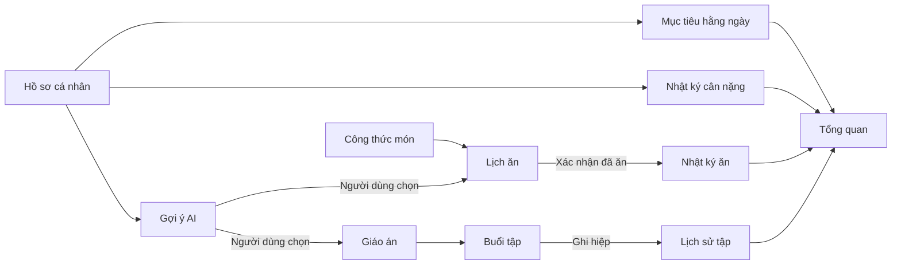

# Bản đồ nghiệp vụ MealPlaning

Bản đồ nối thao tác trong ứng dụng với mã sở hữu dữ liệu và kiểm thử tương ứng. Liên kết kiểm thử dẫn tới kịch bản trong mã nguồn. Kết quả chạy phụ thuộc phiên bản và môi trường.

## Hồ sơ cá nhân

[Thiết lập ban đầu](../../src/app/features/onboarding/) tạo một hồ sơ. [Cài đặt](../../src/app/features/settings/) đọc lại hồ sơ và mở từng màn chỉnh sửa. [ProfileStore](../../src/app/core/stores/profile.store.ts) điều phối lưu và tải. [UserProfileRepository](../../src/app/core/repositories/user-profile.repository.ts) ghi bảng `user_profile`.

| Thao tác | Quy tắc và nơi sở hữu | Nơi dùng | Kiểm thử |
|---|---|---|---|
| Nhập hoặc sửa thông số cơ thể | [Quy tắc số đo](../../src/app/core/models/body-measurements.ts) nhận chiều cao 100–250 cm, cân nặng 30–300 kg và tuổi nguyên 10–120. | Thiết lập ban đầu, [màn cơ thể](../../src/app/features/settings/body-edit/), mục tiêu và Tổng quan | [Lưu hồ sơ](../../src/app/core/repositories/user-profile.repository.spec.ts), [chỉnh thông số](../../src/app/features/settings/body-edit/body-edit.page.spec.ts) |
| Nhập tuổi hoặc khai ngày sinh | [Trường tuổi](../../src/app/shared/forms/profile-age-field/) nhận ngày sinh tùy chọn. [Quy tắc sinh nhật](../../src/app/core/services/profile/profile-birth-date.ts) tính tuổi theo ngày địa phương. Hồ sơ cũ giữ tuổi nhập tay. | Thiết lập ban đầu, Cài đặt và [tính lại khi đổi số đo](../../src/app/core/services/profile/profile-measurement-update.ts) | [Ngày sinh](../../src/app/core/services/profile/profile-birth-date.spec.ts), [nâng phiên bản dữ liệu](../../src/app/core/services/database/migrations.spec.ts), [lưu hồ sơ](../../src/app/core/repositories/user-profile.repository.spec.ts) |
| Đổi cân nặng và xem lại | [Quy tắc ghi lần cân](../../src/app/core/services/database/profile-weight-log-trigger.ts) ghi một giá trị mỗi ngày khi cân nặng thay đổi. Sửa lại trong ngày giữ ghi chú cũ. | [Tổng quan](../../src/app/core/stores/dashboard.store.ts) đọc lần cân gần nhất. [Thống kê tập](../../src/app/core/repositories/workout.repository.ts) đọc trung bình tuần. | [Nhật ký cân](../../src/app/core/services/database/profile-weight-log-trigger.spec.ts), [Tổng quan](../../src/app/core/stores/dashboard.store.spec.ts) |
| Chọn mức vận động | [Quy tắc năng lượng](../../src/app/core/services/profile/energy-targets.ts) ánh xạ mức vận động sang hệ số tính nhu cầu năng lượng. | Thiết lập ban đầu, [màn vận động](../../src/app/features/settings/activity-edit/), mục tiêu tự động | [Màn vận động](../../src/app/features/settings/activity-edit/activity-edit.page.spec.ts), [tính lại](../../src/app/core/services/profile/recalc-targets.spec.ts) |
| Chọn trình độ tập | [Kiểu hồ sơ](../../src/app/core/models/user-profile.types.ts) chuyển kinh nghiệm ban đầu thành trình độ tập. Màn vận động cho đổi trình độ đã lưu. | [Chỉ số ưu tiên](../../src/app/core/utils/key-metric-router.ts), [tạo giáo án AI](../../src/app/core/services/ai/fitness-ai.ts) | [Chọn chỉ số](../../src/app/core/utils/key-metric-router.spec.ts), [màn vận động](../../src/app/features/settings/activity-edit/activity-edit.page.spec.ts) |
| Đặt mục tiêu | [Quy tắc tính lại](../../src/app/core/services/profile/recalc-targets.ts) phân biệt mục tiêu năng lượng và protein tự động với [giá trị nhập tay](../../src/app/core/services/profile/manual-targets.ts). Carbohydrate và chất béo có thể để trống. | [Màn mục tiêu](../../src/app/features/settings/goals-edit/), Tổng quan, lịch ăn và gợi ý AI | [Chỉnh mục tiêu](../../src/app/features/settings/goals-edit/goals-edit.page.spec.ts), [tính lại](../../src/app/core/services/profile/recalc-targets.spec.ts) |
| Bật hoặc tắt nhắc lịch | [Lựa chọn trong hồ sơ](../../src/app/core/services/notifications/notification-preferences.ts) và quyền hệ điều hành cùng quyết định lịch nào hoạt động. [Giờ nhắc](../../src/app/core/services/notifications/notification-schedule.ts) xác định giờ hiển thị và giờ đặt lịch. | Cài đặt và [bộ lập lịch thiết bị](../../src/app/core/services/notifications/local-notifications.ts) khi mở ứng dụng | [Cài đặt](../../src/app/features/settings/settings.page.spec.ts), [nhắc lịch](../../src/app/core/services/notifications/local-notifications.spec.ts) |
| Mở lại ứng dụng | [Bộ điều hướng](../../src/app/core/guards/onboarding-guard.ts) dùng trạng thái hoàn tất thiết lập. Hồ sơ và tùy chọn sống qua lần mở lại. | [Khởi động](../../src/app/app.ts), [các tuyến](../../src/app/app.routes.ts) | [Kho trạng thái](../../src/app/core/stores/profile.store.spec.ts), [kịch bản mở lại](../../e2e/specs/onboarding-persist.e2e.ts) |

Mức vận động mô tả hoạt động thường ngày. Trình độ tập mô tả kinh nghiệm tập. Đổi trình độ không kéo theo đổi hệ số vận động.

Giới hạn nhập số liệu phục vụ ghi hồ sơ. Công thức năng lượng có phạm vi riêng, từ 19 đến 78 tuổi. Với sinh nhật 29/2, ứng dụng tăng tuổi ngày 28/2 trong năm thường.

[Vòng đời ứng dụng](../../src/app/app.ts) yêu cầu cập nhật tuổi khi trở lại màn hình và khi sang ngày mới. Ngày sinh để trống giữ tuổi do người dùng nhập.

## Ăn uống

| Thao tác | Dữ liệu và quy tắc | Màn hình đọc | Kiểm thử |
|---|---|---|---|
| Tạo, tìm, sửa hoặc xóa nguyên liệu | [Kho nguyên liệu](../../src/app/core/repositories/ingredient.repository.ts) lưu dinh dưỡng trên 100 g và đếm món đang dùng. | [Quản lý](../../src/app/features/management/), sửa công thức, tra nguyên liệu bằng AI | [Kho nguyên liệu](../../src/app/core/repositories/ingredient.repository.spec.ts) |
| Soạn hoặc sửa món | [Kho món](../../src/app/core/repositories/dish.repository.ts) lưu công thức và số khẩu phần. [Chi tiết công thức](../../src/app/core/repositories/dish-ingredient.repository.ts) lưu khối lượng nguyên liệu theo gram. | Danh mục, chọn món, Lịch ăn | [Kho món](../../src/app/core/repositories/dish.repository.spec.ts), [chi tiết công thức](../../src/app/core/repositories/dish-ingredient.repository.spec.ts) |
| Tính dinh dưỡng một khẩu phần | [Phép quy đổi](../../src/app/core/models/nutrition.ts) dùng đơn vị của đầu vào. [Truy vấn khẩu phần](../../src/app/core/repositories/dish-per-serving.sql.ts) tính từ tổng công thức và số khẩu phần. | Sửa món, chọn món, Tổng quan và Lịch ăn | [Công thức hai khẩu phần qua nhiều màn](../../src/app/core/services/nutrition/nutrition-query.spec.ts) |
| Lên lịch, đổi khẩu phần, chuyển hoặc chép món | [Kho lịch ăn](../../src/app/core/repositories/planned-dish.repository.ts) quản lý món, thứ tự và trạng thái trong từng bữa. [Kho ngày](../../src/app/core/repositories/day-plan.repository.ts) tìm ngày và bữa. | [Lịch ăn](../../src/app/features/calendar/), bữa tiếp theo trên Tổng quan | [Thao tác lịch](../../src/app/core/repositories/planned-dish.repository.spec.ts), [kho ngày](../../src/app/core/repositories/day-plan.repository.spec.ts) |
| Đánh dấu đã ăn, xóa, hoàn tác hoặc chép tuần | Kho lịch ăn lưu số liệu lúc xác nhận. Món dự kiến tiếp tục dùng công thức hiện tại. Sao chép bảo toàn bữa đã ăn ở đích. | Lịch ăn, Tổng quan, lịch sử ăn | [Đổi công thức, hoàn tác và chép tuần](../../src/app/core/services/nutrition/nutrition-query.spec.ts), [trạng thái lịch](../../src/app/core/stores/calendar.store.spec.ts) |
| Xem tổng và xu hướng | [Truy vấn dinh dưỡng](../../src/app/core/services/nutrition/nutrition-query.ts) phân biệt tổng dự kiến cả ngày với tổng đã ăn. Xu hướng dùng món đã ăn. | [Tổng quan](../../src/app/features/dashboard/), tóm tắt ngày và tuần | [Truy vấn dinh dưỡng](../../src/app/core/services/nutrition/nutrition-query.spec.ts), [trạng thái Tổng quan](../../src/app/core/stores/dashboard.store.spec.ts) |
| Điều chỉnh món từ ảnh và xác nhận | [Khẩu phần ảnh](../../src/app/core/models/photo-meal.ts) quy đổi dinh dưỡng khi đổi gram. [Kho bữa từ ảnh](../../src/app/core/repositories/photo-meal.repository.ts) lưu nguyên liệu, món và bữa đã ăn trong một giao dịch. | Bản xem trước trên Tổng quan, Lịch ăn, danh mục | [Gửi hai lần và hoàn tác giao dịch lỗi](../../src/app/core/repositories/photo-meal.repository.spec.ts) |

Một nguyên liệu có đơn vị g. Một công thức có số khẩu phần thành phẩm. Một bữa có số khẩu phần người dùng định ăn. Ba đại lượng phục vụ ba thao tác khác nhau.

## Tập luyện

| Thao tác | Dữ liệu và quy tắc | Màn hình đọc | Kiểm thử |
|---|---|---|---|
| Tìm bài, chọn mẫu, đổi ngày, thay bài và lưu giáo án | [Kho bài tập](../../src/app/core/repositories/exercise.repository.ts) cấp bài. [Kho giáo án](../../src/app/core/repositories/training-plan.repository.ts) lưu ngày, bài dự kiến và giáo án đang chọn. | [Trình sửa giáo án](../../src/app/features/fitness/components/plan-editor/), tab Tập luyện | [Giáo án và kho buổi tập](../../src/app/core/repositories/fitness.repositories.spec.ts) |
| Tạo giáo án từ AI | [Quy tắc bài dự kiến](../../src/app/core/models/fitness-prescription.ts) giới hạn hiệp, số lần và thời gian nghỉ. [Dịch vụ giáo án](../../src/app/core/services/ai/fitness-ai.ts) đối chiếu bài do AI chọn. | Trình sửa giáo án, kho giáo án | [Quy tắc giáo án](../../src/app/core/models/fitness-prescription.spec.ts), [dịch vụ AI](../../src/app/core/services/ai/ai-feature-services.spec.ts) |
| Bắt đầu theo giáo án hoặc tập tự do | [Kho buổi tập](../../src/app/core/repositories/workout.repository.ts) giữ trạng thái đang tập và sao lại chỉ tiêu khi bắt đầu buổi theo giáo án. | [Màn buổi tập](../../src/app/features/fitness/), [kho trạng thái tập](../../src/app/core/stores/fitness.store.ts) | [Giữ chỉ tiêu và khôi phục buổi](../../src/app/core/repositories/fitness.repositories.spec.ts) |
| Ghi, bỏ qua, lặp, sửa hoặc xóa hiệp | [Quy tắc hiệp](../../src/app/core/models/fitness-workout-set.ts) phân biệt số lần và giây. Hiệp bỏ qua không đóng góp khối lượng. | Màn buổi tập, [bộ đếm nghỉ](../../src/app/features/fitness/components/rest-timer/), lịch sử | [Hiệp, đơn vị và khối lượng](../../src/app/core/repositories/fitness.repositories.spec.ts), [trạng thái tập](../../src/app/core/stores/fitness.store.spec.ts) |
| Hủy, hoàn tác, hoàn thành và xem lại | Kho buổi tập giữ các hiệp khi hủy. Kho tính lại khối lượng từ các hiệp có đơn vị phù hợp. | [Lịch sử](../../src/app/features/fitness/history/), chi tiết buổi tập và thống kê tuần | [Khôi phục buổi và đối chiếu tổng](../../src/app/core/repositories/fitness.repositories.spec.ts), [màn lịch sử](../../src/app/features/fitness/history/history.page.spec.ts) |

## AI và tích hợp

[AiGeneration](../../src/app/core/services/ai/ai-generation.ts) chọn nhà cung cấp theo khả năng văn bản hoặc ảnh. [AiAvailability](../../src/app/shared/ai-availability.ts) cung cấp trạng thái cho giao diện. [NetworkStore](../../src/app/core/stores/network.store.ts) theo dõi kết nối.

| Điểm vào | Dịch vụ sở hữu quyết định | Kiểm thử |
|---|---|---|
| Tra dinh dưỡng, điền món, gợi ý thực đơn | [Dịch vụ theo tính năng](../../src/app/core/services/ai/) kiểm tra dữ liệu trả về. [Bộ áp dụng gợi ý](../../src/app/core/services/ai/dish-autofill-applier.ts) cập nhật công thức. | [Tra dinh dưỡng](../../src/app/core/services/ai/nutrition-ai.spec.ts), [áp dụng gợi ý](../../src/app/core/services/ai/dish-autofill-applier.spec.ts), [các tính năng AI](../../src/app/core/services/ai/ai-feature-services.spec.ts) |
| Lập lịch ăn, tạo giáo án, nhận xét ngày | [Lập lịch](../../src/app/core/services/ai/meal-plan-ai.ts), [giáo án](../../src/app/core/services/ai/fitness-ai.ts) và [nhận xét](../../src/app/core/services/ai/insight-ai.ts) chọn dữ liệu gửi theo nghiệp vụ. | [Lập lịch](../../src/app/core/services/ai/meal-plan-ai.spec.ts), [nhận xét](../../src/app/core/services/ai/insight-ai.spec.ts) |
| Chụp ảnh hoặc chọn ảnh món | [Camera](../../src/app/core/services/camera/) lấy ảnh. [Phân tích ảnh](../../src/app/core/services/ai/food-image-ai.ts) tạo bản nháp để người dùng sửa trước khi lưu. | [Phân tích ảnh](../../src/app/core/services/ai/food-image-ai.spec.ts), [kho bữa từ ảnh](../../src/app/core/repositories/photo-meal.repository.spec.ts) |
| Gửi yêu cầu, nhận lỗi hoặc mất mạng | [Groq](../../src/app/core/services/ai/groq-client.ts) và [Gemini](../../src/app/core/services/ai/gemini-client.ts) chuyển yêu cầu qua mạng. [Mẫu lệnh](../../src/app/core/services/ai/prompts/) mô tả đầu vào và cấu trúc kết quả. | [Chọn nhà cung cấp và ánh xạ lỗi](../../src/app/core/services/ai/ai-generation.spec.ts), [trạng thái nút](../../src/app/shared/ai-availability.spec.ts) |

Các kiểm thử dùng phản hồi mẫu có thể phát hiện sai cấu trúc hoặc sai luồng lưu. Độ chính xác khi nhận diện món Việt cần ảnh có khối lượng đối chứng.

## Phạm vi kỹ thuật

| Nhóm mã | Trách nhiệm và cách đối chiếu |
|---|---|
| Khởi động và vòng đời | [Điểm vào](../../src/main.ts), [khung ứng dụng](../../src/app/app.ts), [thanh tab](../../src/app/tabs/), [chặn điều hướng](../../src/app/core/guards/) và [cấu hình tuyến](../../src/app/app.routes.ts) đưa người dùng tới màn phù hợp. |
| Hiển thị và nhập liệu | [Thành phần dùng chung](../../src/app/shared/components/) hiển thị và nhận lựa chọn. [Biểu mẫu](../../src/app/shared/forms/) chứa trường nhập, ánh xạ, xác thực và xác nhận bỏ thay đổi. |
| Giao diện từng nền tảng | [Giao diện chung](../../src/global.scss), [biến thiết kế](../../src/theme/), [dịch vụ giao diện](../../src/app/core/services/theme/), [kiểu bổ sung](../../src/types/) và [tài nguyên](../../src/assets/) phục vụ bốn tab. |
| Điều phối và tiện ích | [Các kho trạng thái](../../src/app/core/stores/) giữ trạng thái màn hình. [Tiện ích](../../src/app/core/utils/) xử lý ngày địa phương, tuần, tìm kiếm và chọn chỉ số. [Hàng đợi hoàn tác](../../src/app/core/services/undo-toast-queue.ts) điều phối thông báo. |
| Lưu trữ và tương thích | [Lớp cơ sở dữ liệu](../../src/app/core/services/database/) chứa schema, nâng phiên bản, giao dịch web và SQLite thiết bị. [Các kho dữ liệu](../../src/app/core/repositories/) chuyển quyết định nghiệp vụ thành thao tác lưu. |
| Tạo và nạp dữ liệu mẫu | [Bộ tạo và kiểm định](../../scripts/seed/) đọc dữ liệu biên soạn. [Bộ nạp](../../src/app/core/services/seed/) nhập [tài nguyên xuất bản](../../src/assets/seed/). [Kiểm thử sản phẩm xuất](../../scripts/seed/__tests__/gram-artifacts.test.ts) đối chiếu đơn vị. |
| Android và cấu hình build | [Capacitor](../../capacitor.config.ts) kết nối mã web với [vỏ Android](../../android/app/src/main/). [Lệnh build](../../package.json), [tập lệnh đồng bộ](../../scripts/postsync-android.mjs) và [tập lệnh phát hành](../../scripts/release/) tạo gói ứng dụng. |
| Cấu hình khóa AI | [Cấu hình môi trường](../../src/environments/) và [tập lệnh chuẩn bị Groq](../../scripts/prepare-groq-config.mjs) phục vụ build. [Tập lệnh Gemini](../../scripts/obfuscate-gemini-key.mjs) chuẩn bị cấu hình nhà cung cấp còn lại. |
| Kiểm thử và công cụ dự án | [Đặc tả đầu cuối](../../e2e/specs/), [cấu hình chạy](../../e2e/wdio.conf.ts), [quy trình CI](../../.github/workflows/), [kiểm tra tĩnh và công cụ QA](../../scripts/), [Git hooks](../../.husky/) kiểm tra các lớp khác nhau. |
| Tài liệu, trợ lý và dữ liệu tạo sẵn | [Tài liệu sản phẩm](../), [hồ sơ BMAD](../../_bmad-output/), [quy trình trợ lý](../../.claude/), [hướng dẫn GitHub](../../.github/) và [bằng chứng QA](../../.qa-evidence/) cung cấp ngữ cảnh phát triển. |

Các thư mục `node_modules/`, `.angular/`, `www/` và `coverage/` chứa phụ thuộc hoặc kết quả tạo tự động. Android còn chứa tài nguyên đồng bộ và kết quả Gradle. Tệp SQLite tạm và ảnh QA lưu dữ liệu tại thời điểm chụp. Chúng không chứng minh hành vi của bản build hiện hành.

[BMAD](../../_bmad/) và [kỹ năng soạn yêu cầu](../../prompt-master/) phục vụ phát triển. [Công cụ tra thiết kế](../../.github/prompts/ui-ux-pro-max/scripts/) chạy ngoài ứng dụng. Kế hoạch trong `.hermes/` và bản nháp trong `.superpowers/` ghi ý định tại thời điểm viết.

## Cách áp dụng các sách kỹ thuật

Theo Evans, “khẩu phần” mang nghĩa riêng trong công thức và trong lịch ăn. Theo Martin, công thức dinh dưỡng nhận số liệu và đơn vị trực tiếp. Thành phần Ionic hay trình kết nối SQLite chỉ gọi công thức khi cần.

Theo Feathers, ca mở lại bữa đã ăn giữ một con số kỳ vọng độc lập trước khi đổi nơi tính. Theo McConnell, màn thiết lập và màn sửa dùng cùng giới hạn số đo. Mức tuổi nhận vào hồ sơ và mức tuổi cho phép ước tính vẫn có quy tắc riêng.

## Phân biệt kết quả kiểm chứng

Kiểm thử kho dữ liệu đối chiếu dữ liệu trước và sau thay đổi. Kiểm thử giao diện kiểm tra cách màn hình gọi nghiệp vụ. Các đặc tả Android hiện bao phủ khởi động, lưu thiết lập và một số biểu mẫu.

[Ca bữa đã ăn](../../src/app/core/services/nutrition/nutrition-query.spec.ts) giữ 180 kcal khi mở lại sau khi sửa công thức. [Ca buổi tập](../../src/app/core/repositories/fitness.repositories.spec.ts) đối chiếu 642,5 kg giữa buổi đang tập, lịch sử và thống kê tuần.

Một lượt kiểm thử tự động dùng dữ liệu mẫu chưa chứng minh độ chính xác y khoa của mục tiêu năng lượng. Việc cấp quyền thông báo, hiển thị bàn phím và nhận diện ảnh thật cần nghiệm thu riêng trên thiết bị.

## Nghiệm thu hồ sơ trên Android ngày 24/11/2026

Giả lập Android API 36 nâng tại chỗ từ SQLite phiên bản 9 lên 10. Hồ sơ thử giữ tuổi nhập tay 30 và hai mục tiêu 2100 kcal, 130 g protein. Qua Cài đặt, người thử khai ngày sinh, đổi sang 72,5 kg và chọn trình độ nâng cao. Tổng quan hiện 72,5 kg, cao hơn lần cân trước 4,5 kg. Mở lại ứng dụng vẫn giữ các giá trị đã lưu. [Ảnh Cài đặt](../../.qa-evidence/2026-11-24-profile/settings.png) · [Kết quả SQLite](../../.qa-evidence/2026-11-24-profile/results.json)

Thu quyền thông báo trên Android giữ lựa chọn nhắc bữa sáng trong hồ sơ. Cài đặt báo tạm dừng và cho xin lại quyền. Sau khi chấp nhận qua hộp thoại Android, bộ lập lịch có đúng một lịch bữa sáng.

Trên bản cài mới, ngày sinh cho tuổi 8 khiến bước thiết lập báo lỗi. Hồ sơ hợp lệ dùng ngày sinh 25/11/1996. Người thử đặt đồng hồ giả lập sát nửa đêm và giữ nguyên màn Cài đặt. Lúc 00:00 ngày 25/11, tuổi tăng từ 29 lên 30 và mục tiêu tự động đổi từ 2232 xuống 2225 kcal.

Khi giờ địa phương đổi trong lúc mở lại ứng dụng, bản trước từng giữ tuổi cũ hơn 9 giây. Sau khi sửa, hai chiều đổi ngày cập nhật tuổi trên Cài đặt và trong SQLite sau 0,46 giây và 0,84 giây. Khi giữ nguyên màn hình và chỉ đổi múi giờ hệ thống, tuổi cập nhật sau 54 giây.
